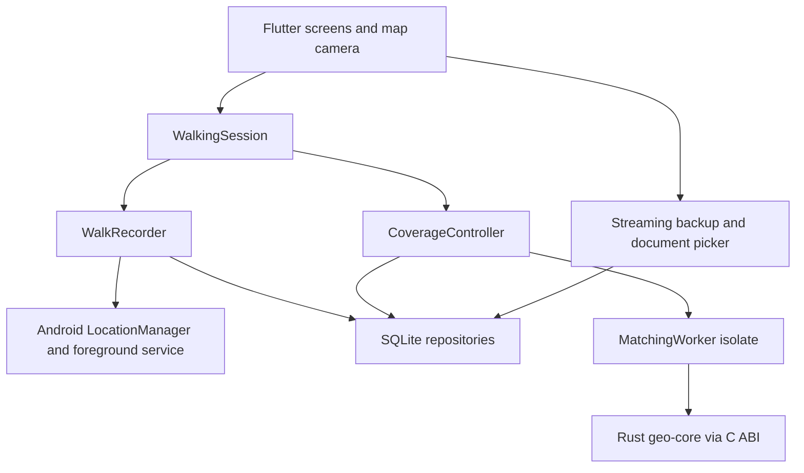

# Wanderlust architecture

The Android application uses Flutter for presentation and application services,
SQLite for local data, and a Rust core for street matching. This document describes
the implementation as of October 2026; older ADRs also contain proposed directions.

## Ownership and boundaries

`WalkingSession` owns the shared store, recorder and coverage controller, applies
preferences and coordinates live coverage. It settles coverage work before closing
the recording store. `MapLocationController` owns GPS requests and camera intent;
late replies cannot undo a map gesture or move the camera after hiding the app.
`MapMemoriesController` loads pins and recovers drafts. `MapScreen` composes the
screen and routes navigation; its toolbar, location control, dock, coverage status,
welcome layout and recording panel are separate widgets.

`AppDatabase` owns the SQLite connection and current schema. `WalkRepository`,
`OfflineMapRepository`, `CoverageRepository`, `PreferencesRepository` and
`MemoryStore` own their data access. `BackupImporter` coordinates one transaction
across them. Map writes and preference writes expose transaction-aware helpers so
restore uses the same policies without opening nested transactions. Interrupted
recording recovery also has one implementation shared by full and summary reads.
`SqliteWalkStore` remains a source-compatible delegating facade for existing callers;
it contains no SQL or business rules. New storage logic belongs in the repositories,
not in that facade.

Session and transfer code depend on `WalkStore` (journal), `WalkHistory`,
`AreaStore`, `CoverageStore`, `PreferencesStore`, `MemoryRepository` and
`WalkImporter` contracts. They do not construct SQLite implementations. The map
screen currently assembles these dependencies from the compatibility facade;
`WalkRecorder` now requires an injected journal. In-memory test implementations
exercise the history UI and transfer service without SQLite subclasses.

`PreferencesController` serializes startup reads and saves; failures do not poison
the queue and do not publish an unpersisted value. Session shutdown drains accepted
preference work before closing the journal. `MapMemoriesController` publishes
immutable lists and ignores superseded read results/errors. Concurrent refreshes
share pending photo recovery; an explicit later recovery can retry a failure.

## Source data and derived data

Raw fixes are committed incrementally, with timestamps and measured accuracy.
Process death leaves a journal that reopens as interrupted; it does not silently
restart GPS. Display distance is a separate conservative estimate: inaccurate
fixes, non-increasing timestamps, outages, implausible speed and tiny jitter do
not add distance. Those display decisions do not remove raw recordings.

The heatmap counts distinct walks per street section. A section is an OSM way
split at graph junctions, retaining intermediate shape points. Rust requires
movement evidence and supports optional bounded gap interpolation. Coverage is
derived and replaceable; walk membership updates are transactional and idempotent.
Matching revision, gap policy and a trace fingerprint invalidate old results.

The new `com.simiono.wanderlust` identity starts schema version 1, created directly
with all current tables and columns. Experimental migrations are removed. An
application marker rejects unrelated databases without resetting them. Completed
and imported traces receive a cached fingerprint on their first summary read;
later reads load metadata and point counts, not full traces. Review, export and pending matching load the relevant
trace on demand. A summary cannot be exported as an empty walk.

## Matching and rendering

`MatchingSession` owns a bounded LRU cache of two native matchers. Live coverage
uses it inside a dedicated Dart isolate; review and one-shot matching use the same
implementation in their background isolates. Repeated
live updates reuse graphs; eviction and shutdown free native handles. Coverage
operations are serialized, and previews never commit unfinished walks. Hidden-app
previews pause while GPS journaling continues.

The map is a Flutter CustomPainter over offline GeoJSON, **not MapLibre or
PMTiles**. It draws streets, heat, scenery, labels, location and memory pins.
Geometry paths are cached by projection, map set and viewport size; offscreen
paths are culled. Heat counts and location updates do not need to rebuild static
paths. Labels still lay out in screen coordinates while panning.

A normal recording requests high-accuracy fixes every five seconds with a
five-metre distance filter; the GPS slider offers 2, 5, 10 and 20 seconds, with a
two-metre movement filter at 2 s and five metres otherwise. These
are OS requests, not guaranteed sampling intervals or adaptive sampling. The
vendored Android geolocator uses platform LocationManager without a Google Play
Services SDK dependency. User-started recording uses a location foreground
service and partial wake lock. The elapsed display timer is off when hidden or
when the clock preference is disabled.

## Backup and restore

Android exports `.wanderlust` version-4 archives through a streamed document copy.
The format has a magic header, length-delimited records with SHA-256 checksums,
and a mandatory final record count. Settings, maps, individual walks, memory
metadata and raw photo bytes are separate records. This is an application format,
not ZIP. Checksums detect corruption; backups are not encrypted or authenticated.

`WalkTransfer` owns document selection, preparation, photo validation, export and
staging cleanup. The history screen supplies a restore-choice callback and shows
the result. `BackupData` supplies explicit data dependencies to the archive writer;
`WalkImporter` is the transaction boundary. Cancellation is checked after the
restore choice and before commit. `WalkFiles.pickArchive` transfers ownership
of a private temporary copy to the caller, never ownership of the user's original
file. Cleanup runs on cancellation, decoding failure and provider failure.

Photo data is handled one memory at a time. Restore stages photos and walk records
in private temporary files, validates the complete archive and photo decodability,
and then merges through one SQLite transaction. Existing local memories win;
conflicting walk identities reject the import. Cancellation is available before
the transaction starts. Temporary staging is deleted on completion or failure.

Limits: 2 GiB per archive, 32 MiB per record, 8 MiB per photo, eight maps of at most
16 MiB each, 10,000 memories and 100,000 walk records. Each walk retains the GPX
codec's per-walk validation limits. These bounds are resource protections, not a
promise that every phone has sufficient free staging space. Version-4 archives
are the sole full-backup format. JSON/gzip versions 1–3 are rejected; their codecs
and whole-photo export path have been removed. GPX remains supported.

## Verification and remaining work

Unit/widget tests cover recovery, fresh-schema reopening, matching, import rollback, damaged
archives, cancellation and archives containing more than 80 MiB of photos.
Native FFI tests exercise the Rust library; Python checks validate Android setup,
packaging and release tooling.

Run the optional history/matcher benchmark from `app/` with
`WANDERLUST_BENCHMARKS=1 LD_LIBRARY_PATH=../target/release flutter test test/performance_profile_test.dart`.
The fixture has 365 walks and 262,800 fixes. Host measurements are diagnostic, not
mobile performance guarantees. Physical-device battery use, large-area panning,
TalkBack discoverability and outdoor contrast still require field evaluation.

On the development host, the October hardening profile measured 2,098 ms for a
full 365-walk history read versus 11 ms for warm summaries. Ten small Bremen
matching batches took 485 ms with fresh workers versus 3 ms with a warmed cache.
The native test fixture and real matching checks still verify results separately;
these timings isolate loading overhead rather than claiming a phone speedup.

Before the package rename, Android API 35 emulator validation retained three
existing walks across the earlier schema upgrade, exported a v4 archive through the system picker, and restored it
without duplicates, including six memories/drafts and the offline map.

The architecture refactor adds regression checks for both recovery entry points,
late GPS replies during browsing/hide/disposal, and agreement among cached,
one-shot and review matching. That earlier refactor preserved the database and backup format; the October 3
package reset subsequently retired the experimental database lineage and old
backup formats. The map screen still contains navigation/composition code and the
store facade remains a compatibility boundary; this is not a claim that every
remaining class or similar-looking code fragment needs another abstraction.

The second maintainability pass adds deterministic tests for out-of-order memory
reads, recovery retry, queued preference writes and transfer cleanup/cancellation.
These exercise workflow outcomes through domain interfaces, without a database
or widget tree. Existing SQLite tests continue to verify atomic restore rollback.

### Unmatched movement display

The native matcher returns `unmatched` pair-end indices into flattened GPX
points alongside street membership. It excludes unreliable fixes, untimed
pairs, gaps over 30 seconds, motion above 3 m/s and sub-two-metre jitter, and
never joins GPX segments. A pair is covered when both endpoints and its midpoint
have a nearest street within 12 metres that was matched; otherwise it remains
raw GPS evidence. Merely being near a painted neighbour must not hide a short
unmatched section.

`UnmatchedTrails` keeps only derived unmatched coordinates, separate from street
counts. Pair sets are intersected across loaded maps, so one map's coverage
suppresses another map's fallback. Saved trails are rebuilt once per controller
lifetime; live previews replace the complete provisional result as sequence
evidence arrives. The matching revision invalidates old stored coverage. No new database
schema or private-data backup format is required. This currently costs a saved
trace replay on startup; persisting derived trail caches is a future optimisation.

The painter uses a fixed screen-width, dashed grey-green line. Its meaning is
explained in the existing heatmap legend, without adding text to the main map.

### Coverage resolution and automatic extension

`CoverageSections` derives stable 10–20 m pieces (target 15 m) from canonical OSM
parent edges when maps are loaded. Short original junction pieces remain short.
Intermediate shape vertices and original endpoint topology are preserved;
synthetic node IDs reserve the upper half of JSON-safe integers. Saved map
identity and raw download data remain unchanged. A separate `coverageVersion`
selects rebuilt memberships instead of mixing coarse and fine counts. Restoring
an older current-format backup therefore needs no re-download to gain finer heat.
Artificial boundaries share their parent edge's motion evidence; they are not
misclassified as ambiguous junctions. The Rust graph's metric grid bounds local
candidate searches while retaining deterministic ties and exact distances.

`AutomaticMaps` listens only to user-started recording fixes, including hidden
recording. Fresh, <=25 m accuracy fixes within 500 m of the union boundary trigger
one 2 km download centred on the fix. Existing overlap seams do not trigger it.
It keeps selection unchanged, never evicts maps, respects the existing eight-map
limit, throttles successful attempts for one minute and failures for five minutes.
Disabling or stopping cancels pending requests; failures leave recording intact.
Saved maps are refreshed into coverage after a successful save. The first map
remains explicit. Settings, first-run text and the privacy policy disclose default
network use; recorded routes are never uploaded.

### Sequence-based street assignment

`geo-core/src/sequence.rs` owns candidate scoring and forward/backward inference.
It uses bounded graph-distance searches rather than independent nearest-fix
choices. `matcher.rs` owns motion-supported coverage and connector safeguards;
longer GPS-outage estimates remain in the shared Dart gap-routing service.
The live controller recomputes full sequences in the worker so provisional
choices can be retracted. Raw recordings and GPX remain independent of derived
coverage. See MATCHING_EVIDENCE.md for thresholds and evaluation limits.
