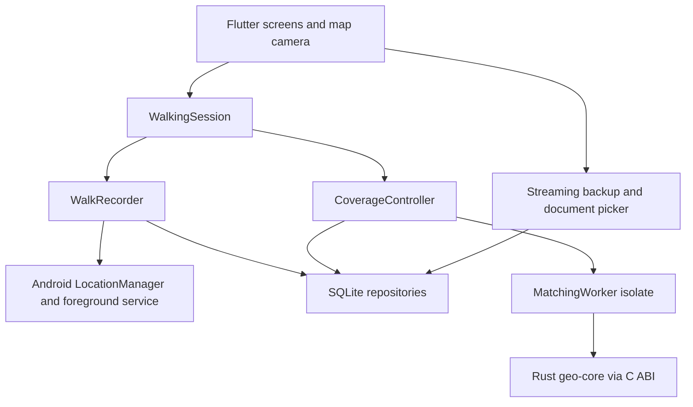

# Wanderlust architecture

The Android application uses Flutter for presentation and application services,
SQLite for local data, and a Rust core for street matching. This document describes
the implementation as of October 2026; older ADRs also contain proposed directions.

## Ownership and boundaries

`WalkingSession` owns the shared store, recorder and coverage controller, applies
preferences and coordinates live coverage. It settles coverage work before closing
the recording store. `MapLocationController` owns GPS requests and camera intent;
late replies cannot undo a map gesture or move the camera after hiding the app.
`MapMemoriesController` loads pins and recovers drafts. `MapScreen` composes the
screen and routes navigation; its toolbar, location control, dock, coverage status,
welcome layout and recording panel are separate widgets.

`AppDatabase` owns the SQLite connection and version-7 schema. `WalkRepository`,
`OfflineMapRepository`, `CoverageRepository`, `PreferencesRepository` and
`MemoryStore` own their data access. `BackupImporter` coordinates one transaction
across them. Map writes and preference writes expose transaction-aware helpers so
restore uses the same policies without opening nested transactions. Interrupted
recording recovery also has one implementation shared by full and summary reads.
`SqliteWalkStore` remains a source-compatible delegating facade for existing callers;
it contains no SQL or business rules. New storage logic belongs in the repositories,
not in that facade.

## Source data and derived data

Raw fixes are committed incrementally, with timestamps and measured accuracy.
Process death leaves a journal that reopens as interrupted; it does not silently
restart GPS. Display distance is a separate conservative estimate: inaccurate
fixes, non-increasing timestamps, outages, implausible speed and tiny jitter do
not add distance. Those display decisions do not remove raw recordings.

The heatmap counts distinct walks per street section. A section is an OSM way
split at graph junctions, retaining intermediate shape points. Rust requires
movement evidence and supports optional bounded gap interpolation. Coverage is
derived and replaceable; walk membership updates are transactional and idempotent.
Matching revision, gap policy and a trace fingerprint invalidate old results.

SQLite schema version 7 adds a trace fingerprint. Older traces receive one during
the first summary load after upgrade. Later history reads load metadata and point
counts, not full traces. Review, export and pending matching load the relevant
trace on demand. A summary cannot be exported as an empty walk.

## Matching and rendering

`MatchingSession` owns a bounded LRU cache of two native matchers. Live coverage
uses it inside a dedicated Dart isolate; review and one-shot matching use the same
implementation in their background isolates. Repeated
live updates reuse graphs; eviction and shutdown free native handles. Coverage
operations are serialized, and previews never commit unfinished walks. Hidden-app
previews pause while GPS journaling continues.

The map is a Flutter CustomPainter over offline GeoJSON, **not MapLibre or
PMTiles**. It draws streets, heat, scenery, labels, location and memory pins.
Geometry paths are cached by projection, map set and viewport size; offscreen
paths are culled. Heat counts and location updates do not need to rebuild static
paths. Labels still lay out in screen coordinates while panning.

A normal recording requests high-accuracy fixes every five seconds with a
five-metre distance filter; Detailed GPS requests two seconds/two metres. These
are OS requests, not guaranteed sampling intervals or adaptive sampling. The
vendored Android geolocator uses platform LocationManager without a Google Play
Services SDK dependency. User-started recording uses a location foreground
service and partial wake lock. The elapsed display timer is off when hidden or
when the clock preference is disabled.

## Backup and restore

Android exports `.wanderlust` version-4 archives through a streamed document copy.
The format has a magic header, length-delimited records with SHA-256 checksums,
and a mandatory final record count. Settings, maps, individual walks, memory
metadata and raw photo bytes are separate records. This is an application format,
not ZIP. Checksums detect corruption; backups are not encrypted or authenticated.

Photo data is handled one memory at a time. Restore stages photos and walk records
in private temporary files, validates the complete archive and photo decodability,
and then merges through one SQLite transaction. Existing local memories win;
conflicting walk identities reject the import. Cancellation is available before
the transaction starts. Temporary staging is deleted on completion or failure.

Limits: 2 GiB per archive, 32 MiB per record, 8 MiB per photo, eight maps of at most
16 MiB each, 10,000 memories and 100,000 walk records. Each walk retains the GPX
codec's per-walk validation limits. These bounds are resource protections, not a
promise that every phone has sufficient free staging space. Legacy v1/v2/v3 JSON
and gzip imports retain their original bounds and remain supported.

## Verification and remaining work

Unit/widget tests cover recovery, migrations, matching, import rollback, damaged
archives, cancellation and archives containing more than 80 MiB of photos.
Native FFI tests exercise the Rust library; Python checks validate Android setup,
packaging and release tooling.

Run the optional history/matcher benchmark from `app/` with
`WANDERLUST_BENCHMARKS=1 LD_LIBRARY_PATH=../target/release flutter test test/performance_profile_test.dart`.
The fixture has 365 walks and 262,800 fixes. Host measurements are diagnostic, not
mobile performance guarantees. Physical-device battery use, large-area panning,
TalkBack discoverability and outdoor contrast still require field evaluation.

On the development host, the October hardening profile measured 2,098 ms for a
full 365-walk history read versus 11 ms for warm summaries. Ten small Bremen
matching batches took 485 ms with fresh workers versus 3 ms with a warmed cache.
The native test fixture and real matching checks still verify results separately;
these timings isolate loading overhead rather than claiming a phone speedup.

Android API 35 emulator validation retained three existing walks across the
schema upgrade, exported a v4 archive through the system picker, and restored it
without duplicates, including six memories/drafts and the offline map.

The architecture refactor adds regression checks for both recovery entry points,
late GPS replies during browsing/hide/disposal, and agreement among cached,
one-shot and review matching. It changes neither the database version nor the
backup format. The map screen still contains navigation/composition code and the
store facade remains a compatibility boundary; this is not a claim that every
remaining class or similar-looking code fragment needs another abstraction.
