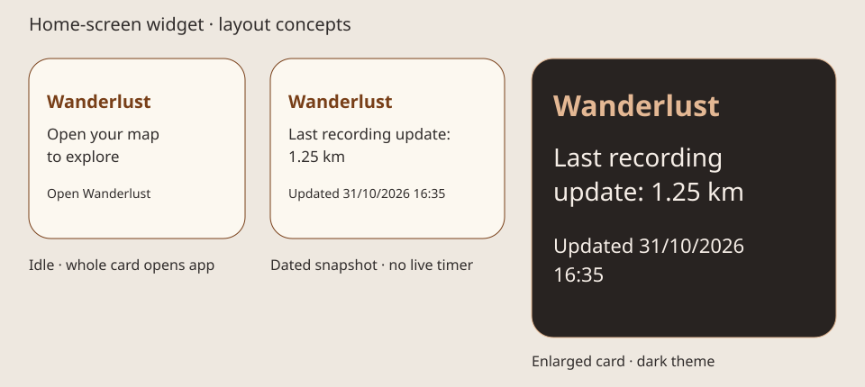

# Android home-screen widget

The optional Wanderlust widget opens the existing app and shows a dated recording
summary. Add it from the launcher's Widgets menu; there is no app setting to enable
it. It starts at roughly three columns by two rows (launcher dependent), with a
minimum content size of 180×110 dp, and can grow in either direction. Enlarge it
when using large system text: a small card shows an open-app shortcut, and resizing reveals the summary. It follows the system light/dark theme.

These are layout concepts. The actual date format follows Android settings.

## Behaviour

- Idle: “Open your map to explore.” Tapping opens Wanderlust.
- Recording: “Last recording update: 1.25 km,” with the update date and time.
- GPS interruption: the last update says GPS needed attention.
- Recoverable session without a running recorder: open the app to check recording.
- Missing/corrupt snapshot: show the normal open-app invitation.

The entire card is one accessible tap target with its complete status/date read by
TalkBack, including text truncated at smaller sizes. There is no widget Stop action
or automatic start: the visible app retains its permission, recovery and stop flows.
An existing open screen is preserved when returning to the app.

The widget deliberately shows a **snapshot**, not a live timer. Android can freeze
or kill a process without a final callback. A stale card therefore keeps its dated
“last update” wording instead of promising that recording is still running.
Opening the app checks the actual recording state. Reboot/force-stop do not cause
the widget to restart GPS. No precise location or map thumbnail is exposed.

## Cost and implementation

`WanderlustWidget.kt` uses framework RemoteViews, an explicit immutable activity
PendingIntent and one small SharedPreferences snapshot. It opens no database,
Flutter engine or map during widget updates. RecordingService passes data it has
already read for the existing notification. Updates are limited to once a minute,
except recording/state transitions and launcher-requested redraws. Without an
installed widget, only state transitions persist a snapshot.

`updatePeriodMillis` is zero. There is no added polling, alarm, background worker,
location request or wake lock. Expected incremental cost is at most one small
preference write and RemoteViews update per minute during recording, plus state
changes. Physical-device battery impact is **not yet measured**; compare otherwise
similar screen-off walks with/without the widget in issue #9.

Widget update exceptions are isolated from recording. Source journeys and backups
remain unchanged. Launcher placement is managed by Android, not by app backups.

## Verification

Native tests cover app-only taps, no journal creation, dated status, throttling,
no periodic writes without widgets, invalid snapshots, update failures, service
stop/destruction and enlarged layout. Overlay tests check provider registration,
zero periodic scheduling and idempotent scaffold generation.

Device acceptance: placement/resizing, normal and 200% text, light/dark themes,
TalkBack, starting/stopping in the app, GPS interruption, process death, reboot and
battery comparison. See the current checklist in issue #9.

Android references: [widget structure](https://developer.android.com/develop/ui/views/appwidgets)
and [updating widgets](https://developer.android.com/develop/ui/views/appwidgets/advanced).
